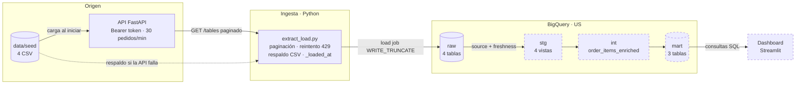
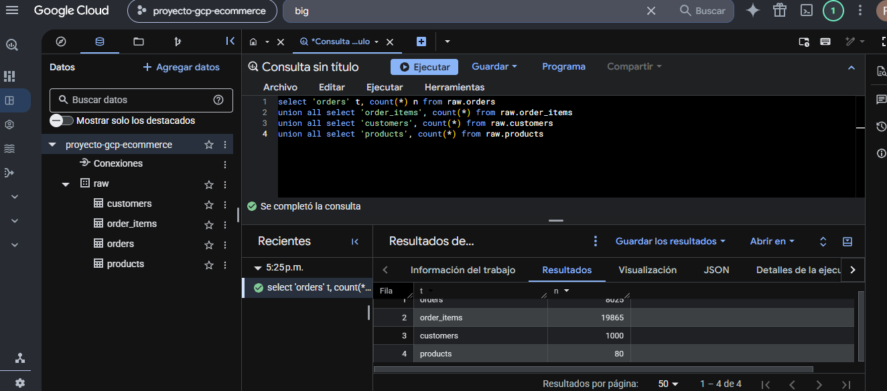

# E-commerce Data Pipeline on GCP

Pipeline ELT de punta a punta para una tienda online. Baja datos de una API con autenticación y límite de pedidos, los carga en **BigQuery** y los transforma por capas con **dbt** hasta llegar a un dashboard que responde tres preguntas de negocio.


> **Estado:** en desarrollo. La ingesta y la capa `raw` en BigQuery están terminadas y probadas. Las capas de transformación en dbt y el dashboard están en curso. Ver [Estado del proyecto](#estado-del-proyecto).

## El problema

Una tienda online tiene sus datos de clientes, productos, pedidos y líneas de pedido detrás de una API, y necesita un tablero que responda:

1. ¿Cómo evolucionan las ventas por mes y por canal?
2. ¿Qué categorías y productos dejan más margen?
3. ¿Qué clientes compran de nuevo y cuánto valen?

Los datos son sintéticos, pero traen los problemas de los datos reales: nulos, formatos mezclados y valores inconsistentes. Encontrarlos y resolverlos es parte del trabajo.

## Qué hace

- **Ingesta robusta desde una API:** paginación con `limit`/`offset`, reintento automático ante el límite de pedidos (HTTP 429 + `Retry-After`) y control de que lleguen exactamente las filas anunciadas.
- **Respaldo automático:** si la API no responde, la corrida completa usa los CSV de origen, con los mismos tipos de dato que la API.
- **Carga idempotente en BigQuery:** cada corrida reemplaza las tablas de `raw` con load jobs, así que correrla dos veces nunca duplica filas.
- **Trazabilidad:** cada fila lleva `_loaded_at` (UTC), la misma marca para toda la corrida, que dbt usa para controlar la frescura.
- **Modelado por capas con dbt:** `raw → stg → int → mart`, cada capa en su propio dataset.
- **Calidad automatizada:** lint, tests y validación del proyecto dbt en cada push y pull request.

## Arquitectura



Los datos cruzan de la máquina a la nube en un único punto, el load job de la ingesta. De `raw` en adelante, todo es SQL de dbt que se ejecuta dentro de BigQuery. Los nodos punteados están en desarrollo. Más detalle, incluido el loop de paginación, en [docs/diagrama.md](docs/diagrama.md).

| Capa | Herramienta | Contenido |
|---|---|---|
| `raw` | Python | Las 4 tablas tal como vienen de la API, más `_loaded_at` |
| `stg` | dbt (vistas) | Espejo 1 a 1 de `raw`, con nombres consistentes y tipos casteados |
| `int` | dbt (vista) | Limpieza y joins: una fila por línea de pedido válida |
| `mart` | dbt (tablas) | Una tabla por pregunta de negocio |

## Capturas

**Capa `raw` cargada en BigQuery** (conteo de filas por tabla después de una corrida de la ingesta):



**Dashboard:** se agregan capturas cuando estén las visualizaciones (ver [Próximas mejoras](#próximas-mejoras)).

## Instalación

**Requisitos:** Python 3.11 o 3.12 y un proyecto de Google Cloud con BigQuery.

```bash
git clone https://github.com/NicolasGomez97/ecommerce-data-pipeline-gcp.git
cd ecommerce-data-pipeline-gcp

python -m venv .venv
# Windows (PowerShell)
.venv\Scripts\Activate.ps1
# macOS / Linux
source .venv/bin/activate

pip install -r requirements-dev.txt
python run.py setup        # crea .env y dbt_project/profiles.yml a partir de los ejemplos
```

### Credenciales de BigQuery

1. En IAM → Cuentas de servicio, creá una cuenta con dos roles: **BigQuery Data Editor** y **BigQuery Job User**.
2. Generá una clave JSON y guardala **fuera del repositorio**.
3. Completá `.env`. Como alternativa a la clave, podés usar `gcloud auth application-default login` con `BQ_METHOD=oauth`.

### Variables de entorno

| Variable | Para qué sirve | Ejemplo |
|---|---|---|
| `API_URL` | URL de la API de origen | `http://127.0.0.1:8000` |
| `API_TOKEN` | Token Bearer de la API | (secreto) |
| `GCP_PROJECT` | Proyecto de Google Cloud | `mi-proyecto` |
| `BQ_LOCATION` | Ubicación de los datasets (la misma en la ingesta y en dbt) | `US` |
| `BQ_METHOD` | `service-account` u `oauth` | `service-account` |
| `GOOGLE_APPLICATION_CREDENTIALS` | Ruta a la clave JSON (fuera del repo) | `C:/Users/yo/.gcp/clave.json` |
| `API_RATE_LIMIT_POR_MINUTO` | Opcional: límite de la API local | `30` |

`.env` y `dbt_project/profiles.yml` están en el `.gitignore`.

## Uso

```bash
# 1. Levantar la API local (en otra terminal)
python -m uvicorn api.main:app --port 8000

# 2. Correr el pipeline
python run.py ingest                 # API -> BigQuery raw (cae al CSV si la API falla)
python run.py ingest --source csv    # sin API
python run.py build                  # dbt build: modelos y tests
python run.py run                    # ingesta + frescura de raw + dbt build
python run.py docs                   # documentación de dbt en el navegador
python run.py dashboard              # dashboard de Streamlit
```

Salida real de una corrida contra la API local:

```text
  customers      1000 filas  origen=api    0.06s
  products         80 filas  origen=api    0.02s
  orders         8025 filas  origen=api    0.24s
  order_items: 429, espero 60s y reintento offset=19000
  order_items   19865 filas  origen=api   60.47s
Cargando en BigQuery (_loaded_at=2026-11-05T20:13:27.484138+00:00)
  proyecto-gcp-ecommerce.raw.customers: 1000 filas
  ...
```

### API de origen

| Método | Ruta | Auth | Descripción |
|---|---|---|---|
| `GET` | `/health` | No | Estado del servicio |
| `GET` | `/tables/{tabla}?limit=1000&offset=0` | Bearer | Una página de `customers`, `products`, `orders` u `order_items` (`limit` máximo 1000) |

```bash
curl -H "Authorization: Bearer $API_TOKEN" "http://127.0.0.1:8000/tables/products?limit=2&offset=0"
```

```json
{
  "table": "products",
  "total": 80,
  "limit": 2,
  "offset": 0,
  "rows": [
    {"product_id": 1, "name": "Lámpara", "category": "Hogar", "price": 93.99, "cost": 53.91, "created_at": "2025-07-13"},
    {"product_id": 2, "...": "..."}
  ]
}
```

Respuestas de error: `401` (token inválido o ausente), `404` (tabla inexistente) y `429` (límite de pedidos, con header `Retry-After` en segundos).

## Calidad y verificación local

```bash
python run.py check     # ruff check + ruff format --check + pytest + dbt parse
pip-audit -r requirements.txt
```

GitHub Actions ([.github/workflows/ci.yml](.github/workflows/ci.yml)) corre lo mismo en cada push a `main` y en cada pull request, sin credenciales: los tests simulan la API y `dbt parse` valida el proyecto sin conectarse a BigQuery.

Los tests ([tests/test_extract_load.py](tests/test_extract_load.py)) cubren paginación, reintento ante 429 sin avanzar el offset, corte ante 401, control de `total`, la regla de tipos, la paridad CSV/API en las 4 tablas y el respaldo automático.

## Decisiones técnicas

Registro completo con alternativas en [docs/decisiones.md](docs/decisiones.md).

- **ELT con capas en BigQuery.** Python solo extrae y carga. Toda la transformación es SQL versionado en dbt, que se ejecuta donde están los datos y queda documentado y testeado.
- **Un origen por corrida.** Si la API falla en cualquier tabla, se releen las 4 del CSV. Nunca se mezclan fotos de momentos distintos en `raw`.
- **Carga idempotente.** Load jobs con `WRITE_TRUNCATE` en lugar de `insert_rows`. Con este volumen, recargar todo es más simple y barato que una lógica incremental.
- **Respeto del límite de la API.** Se espera lo que indica `Retry-After` y se repite el mismo pedido. La espera se ajusta sola a la ventana deslizante de la API.
- **Contrato de tipos explícito.** El CSV de respaldo aplica la misma regla de inferencia que la API, así `raw` tiene el mismo esquema venga de donde venga.
- **Errores tempranos y claros.** Si `raw` ya existe en otra región, la ingesta corta con un mensaje explícito, en vez del `Dataset not found in location` que daría dbt más adelante.
- **Seguridad.** Credenciales solo por variables de entorno, clave de la cuenta de servicio fuera del repo y una cuenta con permisos mínimos (Data Editor + Job User).

## Desafíos técnicos

- **Límite de pedidos con ventana deslizante.** Una corrida completa son 31 pedidos y la API acepta 30 por minuto. Las esperas observadas fueron de 9 a 60 segundos según el estado de la ventana. Por eso se respeta `Retry-After` en lugar de esperar un tiempo fijo.
- **Paridad exacta entre API y CSV.** Pandas infiere tipos con reglas distintas a las de la API. La solución fue leer todo como texto y aplicar la misma regla, verificada con `assert_frame_equal` en las 4 tablas.
- **Fin de la paginación.** La última página de `order_items` trae 865 filas. Cortar cuando la página viene incompleta evita un pedido vacío de más, que además consumiría cupo del límite.
- **Dependencias vulnerables.** `pip-audit` detectó 39 avisos en Pillow 12.3.0, que llegaba por Streamlit. Streamlit 1.66 no aceptaba la versión corregida, así que se actualizó a 1.67.0 y se fijó Pillow 13.0.0.

## Estado del proyecto

| Etapa | Estado |
|---|---|
| API de origen | ✅ Funcionando |
| Ingesta `API → raw` con respaldo CSV | ✅ Terminada, con tests |
| Capa `raw` en BigQuery | ✅ 28.970 filas en 4 tablas |
| CI (lint, tests, dbt parse, auditoría) | ✅ Configurado |
| Modelos `stg` e `int` + tests de datos | 🚧 En desarrollo |
| Marts + test de reconciliación | 🚧 En desarrollo |
| Dashboard | 🚧 En desarrollo (conexión a BigQuery lista) |

## Próximas mejoras

- [ ] Modelos `stg` (espejo tipado de `raw`) y `int_order_items_enriched` (limpieza y joins).
- [ ] Test de frescura de `raw` sobre `_loaded_at`.
- [ ] Marts `mart_sales_monthly`, `mart_product_performance` y `mart_customer_value`.
- [ ] Test de reconciliación: las ventas netas de cada mart tienen que coincidir con las de `int`.
- [ ] Visualizaciones del dashboard, con filtro por fecha.
- [ ] Ejecución programada diaria con GitHub Actions y la cuenta de servicio como secreto.

## Estructura

```text
├── api/                  API de origen (FastAPI): autenticación, paginación y límite de pedidos
├── ingestion/            extract_load.py: API -> BigQuery raw
├── dbt_project/          modelos stg / int / mart, macros y tests
├── dashboard/            app.py: Streamlit sobre el dataset mart
├── tests/                tests de la ingesta (pytest)
├── data/seed/            CSV de origen
├── docs/                 diagrama, decisiones, guía del template e imágenes
├── tickets/              plantillas de requerimientos y tickets
├── .github/workflows/    CI
├── run.py                atajos multiplataforma (también vía Makefile)
└── pyproject.toml        configuración de ruff y pytest
```

## Autor

**Nicolás Gómez** · Data Engineer · Cloud & Data Architecture

[](https://www.linkedin.com/in/nicolas-ramiro-gomez/)
[](https://github.com/NicolasGomez97)

### Créditos

El proyecto parte del template de **Mauro Sebastian Prystupa**, de la comunidad [Sala de máquinas](https://mauroprystupa.com/comunidad/): consigna, dataset sintético, API de origen (`api/main.py`), estructura de dbt y guía de trabajo ([docs/guia/](docs/guia/README.md)). La ingesta, la integración con BigQuery, los tests, el CI y la documentación técnica son trabajo propio.

## Licencia

[MIT](LICENSE). Copyright del template original: Mauro Prystupa.
