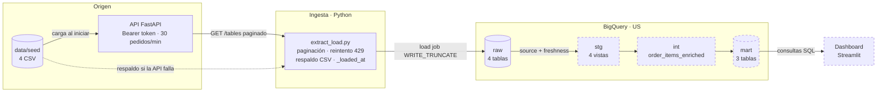
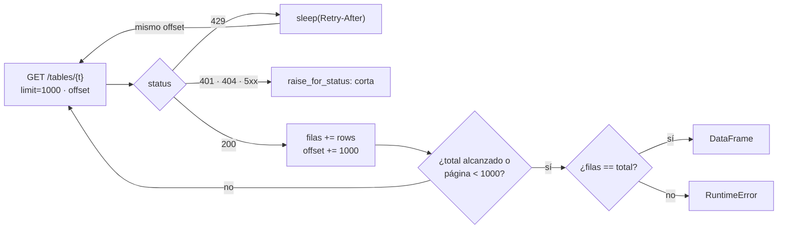

# Diagrama del flujo

El dato sale de los CSV de origen, lo sirve una API con autenticación y límite de pedidos, lo baja la ingesta en Python y lo carga en BigQuery. De `raw` en adelante, todo lo transforma dbt con SQL que corre dentro de BigQuery.

Los nodos punteados están en desarrollo (ver el estado en el [README](../README.md#estado-del-proyecto)).

| Capa | Dónde vive | Quién la crea | Materialización |
|---|---|---|---|
| `raw` | BigQuery, dataset `raw` | `ingestion/extract_load.py` (Python) | Tablas, reemplazadas en cada corrida |
| `stg` | BigQuery, dataset `stg` | dbt | Vistas: espejo 1 a 1 de `raw` con tipos casteados |
| `int` | BigQuery, dataset `int` | dbt | Vista: limpieza y joins |
| `mart` | BigQuery, dataset `mart` | dbt | Tablas: una por pregunta de negocio |
| Dashboard | Streamlit | `dashboard/app.py` | Lee solo `mart` |

## Adentro de la ingesta

